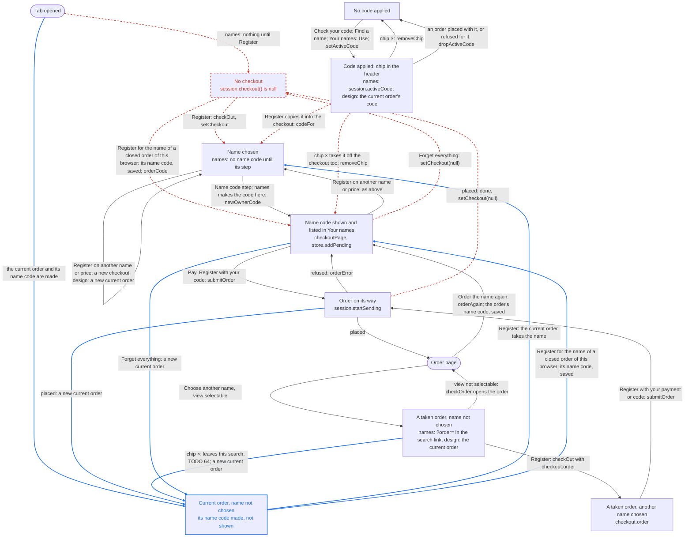
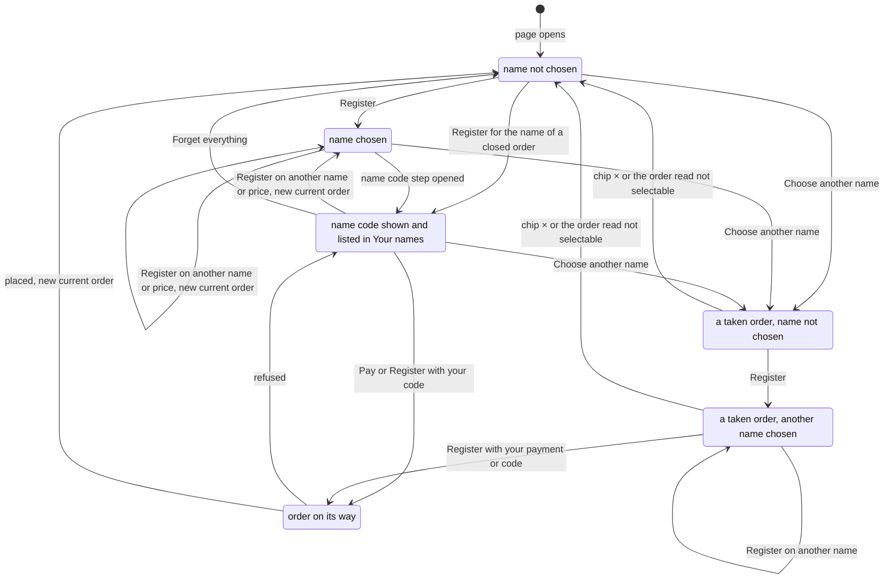

# Names page: one current order per tab

## Scope

The page keeps one current order per tab, in sessionStorage, in place of three records:

- the code applied to the tab: `session.activeCode`;
- the checkout: `session.checkout`;
- the order chosen for another name: `?order=<registration id>` in the search's link, read into `SearchState.order`.

Base: branch `names` at dfa590c.
What buyers see stays as on `names`, except the changes listed in "Visible changes".

## 1. The service's and the page's state machines

Diagram 1 draws both machines and the requests and reads between them.
Diagram 2 draws the tab's records, where the design removes states.

Legend:

- red, dashed: removed by the design;
- blue: added by the design;
- amber: a page state with no phase of the service;
- grey: a phase of the service drawn in a page state shared with other phases;
- thick arrow: a request of the page that moves the service;
- dotted arrow: a phase that the page reads and draws (`GET /api/invoice/<id>`, `GET /api/registration/<id>`, `phase.type`, `screenOf` in src/screens/order.ts).

### Diagram 1: both machines

The service's phases and transitions T1 to T30 are those of simplex-chat apps/simplex-store-service/docs/names.md, section 4.

```mermaid
flowchart LR
  classDef gone stroke:#c0392b,stroke-width:2px,stroke-dasharray:5 5,color:#c0392b
  classDef added stroke:#1f6feb,stroke-width:2px,color:#1f6feb
  classDef pageOnly fill:#fdf3d0,stroke:#b7791f
  classDef shared fill:#e6e6e6,stroke:#777777

  subgraph service["Service: phases of an order"]
    s_unpaid["unpaid"]
    s_closed["closed: expired, cancelled or reversed"]
    s_queued["queued"]:::shared
    s_committing["committing"]:::shared
    s_committed["committed: awaiting, signed or lapsed"]:::shared
    s_registering["registering"]:::shared
    s_registered["registered"]
    s_taken["taken: name not selected"]
    s_failed["failed: registry refused, signature refused or unread"]
    s_month["failed: month ended"]:::shared
    s_ended["ended"]
  end

  subgraph page["Page: webapp/src/views"]
    p_check["Check your code<br/>names.ts checkCodePage"]:::pageOnly
    p_names["Your names: row of an unfinished checkout<br/>names.ts pendingRow"]:::pageOnly
    p_search["Search<br/>search.ts buildSearch"]:::pageOnly
    p_url["Search link with ?order= naming an unknown order, or one not selectable<br/>search.ts searchPage"]:::gone
    p_select["Search for a taken order<br/>names: ?order= in the link; design: the current order"]
    p_steps["Checkout steps: Links, name code, community terms, Check your order<br/>checkout.ts"]:::pageOnly
    p_sending["Order on its way<br/>checkout.ts submitOrder"]:::pageOnly
    p_refused["Checkout refusals: taken, failed, price changed, too many, unavailable, codes only, link<br/>checkout.ts orderError"]:::pageOnly
    p_pay["Order page: pay by coin or card, confirming<br/>order.ts paymentKind"]
    p_card["Order page: card not confirmed<br/>order.ts paymentKind, CARD_SLOW_MS"]:::pageOnly
    p_closed["Order page: invoice closed<br/>order.ts closedCase"]
    p_reg["Order page: registering, 3 stages<br/>order.ts buildRegistering"]
    p_registered["Order page: the name is yours"]
    p_ended["Order page: registration ended"]
    p_taken["Order page: taken or reserved"]
    p_failed["Order page: not registered"]
  end

  s_unpaid -->|T3| s_queued
  s_unpaid -->|T4| s_taken
  s_unpaid -->|T5 T6 T7| s_closed
  s_closed -->|T8| s_closed
  s_queued -->|T9| s_committing
  s_queued -->|T10| s_committed
  s_committing -->|T10| s_committed
  s_committing -->|T11| s_queued
  s_committed -->|T12| s_committed
  s_committed -->|T13 T14| s_queued
  s_committed -->|T15| s_registering
  s_committed -->|T16| s_registered
  s_registering -->|T16| s_registered
  s_registering -->|T17| s_committed
  s_committed -->|T18 T26| s_taken
  s_registering -->|T18| s_taken
  s_queued -->|T19| s_failed
  s_committing -->|T19| s_failed
  s_committed -->|T19 T20 T21| s_failed
  s_registering -->|T19| s_failed
  s_failed -->|T22| s_queued
  s_taken -->|T24| s_queued
  s_failed -->|T25| s_registered
  s_queued -->|T23| s_month
  s_committed -->|T23| s_month
  s_failed -->|T23| s_month
  s_failed -->|T26| s_taken
  s_queued -->|T27| s_closed
  s_committing -->|T27| s_closed
  s_committed -->|T27| s_closed
  s_failed -->|T27| s_closed
  s_committed -->|T28| s_ended
  s_registering -->|T28| s_ended
  s_failed -->|T29| s_ended
  s_registered -->|T30| s_ended

  p_search -->|"Register: checkOut"| p_steps
  p_select -->|"Register: checkOut with the order"| p_steps
  p_steps -->|"Pay, Register with your code or payment: submitOrder"| p_sending
  p_sending -->|"refused: orderError"| p_refused
  p_refused -->|"Back, Search again"| p_search
  p_taken -->|"Choose another name, view selectable: balanceActions"| p_select
  p_select -->|"view no longer selectable, as for a name selected elsewhere: checkOrder opens the order"| p_reg
  p_url -->|"unknown order: opening plain"| p_search
  p_url -->|"failed order: checkOrder opens it"| p_failed
  p_url -->|"unpaid order: checkOrder opens it"| p_pay
  p_select -->|"chip ×: leaves this search, TODO 64"| p_search
  p_closed -->|"Order the name again: orderAgain"| p_steps
  p_check -->|"Find a name: useCode"| p_search
  p_names -->|"Continue checkout"| p_steps
  p_pay -->|"card submitted, not confirmed after 10 minutes"| p_card

  p_sending ==>|"POST /api/invoice: createOrder, T1"| s_unpaid
  p_sending ==>|"POST /api/name/register: registerWithCode, T2"| s_queued
  p_sending ==>|"POST /api/registration/id/name: selectName, T24"| s_queued
  p_pay ==>|"Cancel this invoice: POST /api/invoice/id/cancel, T6"| s_closed
  p_pay ==>|"paid at Stripe or from a coin wallet: the provider settles, T3; T4 while the name is held for another order"| s_queued
  p_reg ==>|"by itself once the wait is over: POST /api/registration/id/reveal, T12 then T15"| s_committed
  p_reg ==>|"by itself once lapsed: POST /api/registration/id/retry, T13"| s_queued
  p_failed ==>|"Continue: POST /api/registration/id/reveal, T22"| s_queued
  p_closed ==>|"Get a new invoice: POST /api/invoice, T1; T5 closes the old order"| s_unpaid

  s_unpaid -.->|"invoice open"| p_pay
  s_closed -.->|"invoice closed"| p_closed
  s_queued -.-> p_reg
  s_committing -.-> p_reg
  s_committed -.-> p_reg
  s_registering -.-> p_reg
  s_registered -.-> p_registered
  s_ended -.-> p_ended
  s_taken -.-> p_taken
  s_taken -.->|"selectable: payment kept, or a code; checkOrder"| p_select
  s_failed -.-> p_failed
  s_month -.-> p_failed

  linkStyle 42,43,44 stroke:#c0392b,stroke-width:2px,stroke-dasharray:5 5
  linkStyle 45 stroke:#1f6feb,stroke-width:2px
```



Where the two machines disagree:

- Page states with no phase: Check your code, the search, the checkout steps, the order on its way, the checkout's refusals, an unfinished checkout's row in Your names, and a card not confirmed: the order exists only in the tab until `POST /api/invoice` or `POST /api/name/register` answers, and a card not confirmed is the page's timer over an invoice the service still reads `unpaid`.
- Phases with no page state of their own: queued, committing, committed and registering are one page state, registering, told apart only by its stage marks (`stagesOf`); failed for its month is one page state with the other failures, not registered.
- One phase, two page states: taken is drawn as the order page's taken or reserved, and as the search for a taken order once the buyer chooses another name.
- The page moves the service by itself: a reveal once the wait is over (`revealDue`), and a retry once lapsed (`retryDue`), in src/screens/order.ts.

### Diagram 2: the tab's records

On `names` the tab keeps three records that change apart: the code applied, the checkout and the `?order=` of the search's link.
The design keeps one current order, which is always present.



### What replaces each removed state and edge

- "No checkout" (diagram 2): the current order with no name chosen, for which `checkout()` in src/session.ts returns null. Removed: `setCheckout(null)` in `sendOrder`'s `done` in src/views/checkout.ts and in `forgetEverything` in src/views/names.ts.
- "Tab opened → No checkout" (diagram 2): the current order made by `session.currentOrder()` when sessionStorage contains none, with its name code from `flow.newOwnerCode`.
- "No checkout → Name chosen" and "No checkout → Name code shown" (diagram 2): `checkOut` in src/views/search.ts writes the name into the current order; `orderCode` in src/screens/search.ts stays.
- "Name chosen: no name code until its step" (diagram 2): the name code made with the current order. Removed: `ownerCode: string | null` in `Checkout`, the `flow.newOwnerCode()` call in `checkoutPage`, and `c.ownerCode &&` in `stepFor`.
- "placed → No checkout" (diagram 2): a new current order, made by `sendOrder`'s `done`.
- "Forget everything → No checkout" (diagram 2): a new current order, made by `forgetEverything` in src/views/names.ts.
- "Register copies the code into the checkout: codeFor" (diagram 2): `codeOf` in src/screens/checkout.ts reads the code applied to the current order, for a name long enough for it. Removed: the `code` that `checkOut` in src/views/search.ts writes from `codeFor`; the checkout's `code` holds only a code entered on Check your order.
- "chip × takes it off the checkout too" (diagram 2): one copy of the code is left to take off. Removed: the `updateCheckout(c.label, { code: null })` branch of `removeChip` in src/views/chrome.ts.
- "Search link with ?order=" and its three edges (diagram 1): the search reads the current order, not its link. Removed: `params.get("order")` in `searchPage`; `Opening`, the `opening` field, the `SearchKind` `"search:order"` and the `opening` argument of `returnedTo` in src/screens/search.ts; the `order` argument of `searchLink` in src/views/shell.ts, with its 8 callers' `c.order?.registrationId` and `view.id`.
- Added, "chip ×: leaves this search" (diagrams 1 and 2): TODO item 64 of the parked #26 branch.

## 2. The current order

### The record

Kept in sessionStorage under the key `simplex-names-checkout`, as the checkout is on `names`.
The key `simplex-names-code` is removed.
`CurrentOrder` in src/session.ts is one of two shapes, told apart by `label`.

Kept in both shapes:

| Field | Type | Contains |
|---|---|---|
| `ownerCode` | `string` | the name code: made with the record, or a closed order's, or the taken order's |
| `saved` | `boolean` | "I have saved my name code" ticked; true for a closed or taken order's code |
| `applied` | `AppliedCode \| null` | the prepaid code applied to the tab, as `session.activeCode` on `names` |
| `order` | `TakenOrder`, optional | the taken order chosen for another name, as `checkout.order` on `names` |
| `label` | `string \| null` | the name chosen at Register; null before |

`TakenOrder`, unchanged from `Checkout.order` on `names`:

| Field | Type | Contains |
|---|---|---|
| `registrationId` | `string` | the service's id of the order |
| `method` | `Method \| "code"` | how the order was placed |
| `paid` | `number` | the order's worth in cents, as the service last read it |

Present with a `label` only (`Checkout`), each as on `names`:

| Field | Type |
|---|---|
| `price` | `number` |
| `years` | `number` |
| `termStart` | `number` |
| `chain` | `ChainInfo` |
| `terms` | `Terms` |
| `community` | `Community \| null` |
| `contact` | `string` |
| `channel` | `string` |
| `method` | `Method` |
| `code` | `AppliedCode \| null` |
| `codeHere` | `boolean`, optional |
| `agreed` | `boolean` |
| `accepted` | `boolean`, optional |
| `termsChanged` | `boolean`, optional |
| `searchAt` | `number` |
| `step` | `CheckoutStep` |
| `unavailable` | `Method`, optional |
| `codeError` | `string`, optional |
| `sent` | `{ of: string; request: SignedOrder; owner: string }`, optional |

`code` contains only a code entered on Check your order.
On `names` it also contains a copy of the tab's code, made at Register.

The code the name is registered with, in src/screens/checkout.ts:

```ts
export const codeOf = (c: Checkout): AppliedCode | null =>
  c.order ? null : c.codeHere ? c.code : c.applied && c.label.length >= c.applied.minLength ? c.applied : null
```

### Its life

| Event | Function | The current order after it |
|---|---|---|
| a page reads it and sessionStorage contains none, or a record without `ownerCode`, or a checkout left by an older page | `currentOrder` | made: a new name code, `saved` false, `applied` null, `label` null |
| Register, the current order with no `label` and no `order` | `checkOut` | takes the name, its own name code |
| Register for the name of a closed order of this browser | `checkOut`, `orderCode` | takes the name and that order's name code, `saved` true |
| Register on the same name, price and chain, not on its way | `checkOut` | keeps its fields, as `updateCheckout` keeps them on `names` |
| Register on another name or price, the current order without `order`, or while its order is on its way | `checkOut` | a new current order, with a new name code, takes the name |
| Choose another name on a taken order's page, view selectable, the order not the current one | `chooseAnother` | a new current order of the taken order: its name code, `saved` true, `order`, `label` null |
| Register on the search for a taken order | `checkOut` | takes the name, keeping `order` |
| its order placed: invoice, code order, selection, or the order of `order_exists` opened | `sendOrder`'s `done` | a new current order |
| × on a taken order's chip | `removeChip` | a new current order |
| the taken order read not selectable, or not in this browser's store | `checkOrder`, `searchPage` | a new current order |
| Order the name again | `orderAgain` | a new record with the order's name, links and name code, `saved` true |
| Forget everything | `forgetEverything` | a new current order |

A new current order keeps `applied`.
`applied` is set by Check your code's Find a name and by Your names' Use (`setActiveCode`).
`applied` is cleared by × on its chip (`setActiveCode(null)`), and by an order registered with it or refused for it (`dropActiveCode`), as on `names`.
The service's id is on the current order only in `order`.

### Its states



Order the name again, from any state, leads to "name code shown" with the order's name code.

### An order with the service's id

The current order contains the service's id only as a taken order whose view is selectable (`api.selectable`).
Register on the search for it moves it to the name searched; `POST /api/registration/<id>/name` sends the move.
Register on another name, before that move is sent, moves it to that name instead.
An order placed and not taken is never the current order.
Register while such an order exists uses the current order, made at the placement, with its own name code.

### A new current order once an order is placed

Awaiting the owner.
A new current order is made once the tab's order is placed, so before it is registered.

### Your names

- A name code is listed as an unfinished checkout once its name code step, community terms step or review opens (`store.addPending` in `checkoutPage`), until an order with that code is stored (`saveOrder`), its order is refused for a name taken (`dropPending`), or Remove is pressed.
- A current order whose name code step never opened lists nothing: a visitor who only searches leaves nothing in Your names.
- The row of the current order's name code offers Continue checkout; other rows offer Find the order.
- Orders are listed from their placement (`saveOrder`), and codes from Check your code (`addCode`), as on `names`.

## 3. Visible changes

1. The chip of a taken order (TODO 64, approved in principle). While the current order is a taken order, the header's chip shows its code, "Code: 10+ letters, 2 years", or for a code order restored without its code text "Code: 2 years", or its payment, "$100 / 2 years", in place of the tab's code or Check your code, on every page. Its × is read "Remove code" for a code and "Leave this search" for a payment. When its × is pressed, a new current order is made, and a checkout step of the order's new name goes to the home. Screens: the home-select and checkout-select screens of section 4.
2. The line "Choose another name for your order." (TODO 64, approved in principle), under the search field, above the answer, on the search for a taken order. Screens: the home-select screens of section 4.
3. The search for a taken order lasts until its move is placed, × is pressed, or it is read not selectable. The home reached by the logo, the menu, Back or a reload is that search, with the chip and the line. On `names` only a link with `?order=` is that search. Screens: none of the baselines.
4. Choose another name ends the tab's unfinished checkout. Its row in Your names offers Find the order in place of Continue checkout from then on. On `names` that happens at Register on a name for the taken order. Screens: none of the baselines.
5. A link with `?order=` is not read. It shows the home with an empty field. On `names` an order not selectable opens its page. No page makes such a link, and the page is not released. Screens: home-select-failed-order and home-select-unpaid, removed.
6. Edge cases:
   - × on the code's chip while its order is on its way: a refusal of that order shows the payment choices. On `names` it shows "Register with your code", from the checkout's copy of the code.
   - A code applied in Check your code or Your names during a checkout is used for that checkout's name when the name is long enough for it, also when the review is reached by Continue checkout. On `names` it is used only after Register.
   - Order the name again, with a code applied that the name is long enough for: the review offers "Register with your code". On `names` it shows the payment choices, as `orderAgain` sets the checkout's `code` to null.
   - Back from an order's page opened because its name was selected elsewhere: the plain search. On `names` the order's page opens again.
   - An unfinished checkout's row removed in Your names is listed again when its name code step, community terms step or review opens, not its Links step. On `names` any step lists it again.
   - Register on a name whose checkout never reached the name code step, after a closed order of that name appeared in another tab: the Links step opens empty. On `names` it keeps the links typed.

## 4. Converging screens

Each group: the existing baselines, the screen they become, and the state that draws it.
Prices are the dev chain's: $100 for 8 letters or more.

1. Becomes home-empty.
   - Existing: home-select-unknown, home-select-failed-order, home-select-unpaid.
   - State: a current order with no `order`; the link's `?order=` is not read.
   - Their tests and baselines are removed.
2. Becomes as home-available-code-free, with the name home-select-code-next, the chip "Code: 10+ letters, 2 years" in place of "Code: 6+ letters, 2 years", the row on one line, and the line "Choose another name for your order.".
   - Existing: home-select-code.
   - State: a taken code order, name not chosen, code of 10 letters or more.
3. Becomes as home-select-code-no-text, with the chip "Code: 2 years" in place of Check your code, and the line.
   - Existing: home-select-code-no-text.
   - State: a taken code order restored without its code text.
4. Becomes as home-codes-only-uncovered, with the chip "Code: 10+ letters, 2 years", the answer "7 letters. Your code covers names of 10 or more letters.", the name hscsht7, and the line.
   - Existing: home-select-code-short.
   - State: a taken code order, a name shorter than its code searched.
5. Becomes as home-select-paid, with the chip "$100 / 2 years" in place of Check your code, and the line.
   - Existing: home-select-paid.
   - State: a taken paid order, a name of its price searched.
6. Becomes as home-taken-no-chats, with the name home-select-own-name, the chip "$100 / 2 years", and the line.
   - Existing: home-select-own-name.
   - State: a taken paid order, its own name searched.
7. Becomes as home-own-unpaid-order, with "Paid" in place of "$100", the name home-select-own-open-order, the chip "$100 / 2 years", and the line.
   - Existing: home-select-own-open-order.
   - State: a taken paid order, the name of this browser's unpaid order searched.
8. Becomes as home-available-terms-unreadable, with "Paid" in place of "$100", the name home-select-terms-unreadable, the chip "$100 / 2 years", and the line.
   - Existing: home-select-terms-unreadable.
   - State: a taken paid order, the terms not readable.
9. Each becomes itself with the chip "$100 / 2 years" in place of Check your code.
   - Existing: checkout-select-paid, checkout-select-busy, checkout-select-held, checkout-select-terms-changed, checkout-select-refused-taken, checkout-select-refused-price, checkout-select-refused-unavailable, checkout-select-refused-failed, checkout-select-refused-other-order.
   - State: a taken paid order, another name chosen.
10. Each becomes itself with the chip "Code: 10+ letters, 2 years" in place of Check your code.
    - Existing: checkout-select-code, checkout-select-refused-code-expired, checkout-select-refused-code-revoked, checkout-select-refused-uncovered.
    - State: a taken code order, another name chosen.

home-select-selected-elsewhere and checkout-select-selected-elsewhere stay as they are: the order's page, after a new current order.

## 5. Changes per file

### src/session.ts

- `TakenOrder`, `Checkout` and `CurrentOrder` as in section 2; `Checkout` loses `ownerCode: string | null` and `order` to the shared fields.
- `currentOrder(): CurrentOrder` reads the record; when it is absent or not one of the two shapes, it writes and returns a new one, with `flow.newOwnerCode()`.
- `newCurrentOrder(): CurrentOrder` writes a new record keeping `applied`.
- `checkout(): Checkout | null` returns the current order with a `label`, with its `step` defaulting to "review" as on `names`, else null.
- `setCheckout(c: Checkout)` takes no null.
- `updateCheckout` unchanged.
- `activeCode()`, `setActiveCode()` and `dropActiveCode()` read and write `applied` of the current order.
- `chooseAnother(order: TakenOrder, ownerCode: string)` writes a new record of the taken order, keeping `applied`, unless `order.registrationId` is the current order's.
- `ACTIVE_CODE` removed.

### src/screens/checkout.ts

- `codeOf` added.
- `codeEntry` and `awaitsCode` read `codeOf(c)` where they read `c.code`.
- `stepFor` reads `c.saved` alone.

### src/screens/search.ts

- `Opening` and the `opening` field removed; `SearchKind` is `"search"`; `screenOf` returns it.
- The `opened` event has no `opening`.
- `returnedTo(s, order, name, tld, orders)` starts anew when `s.order?.registrationId` differs from `order?.registrationId`.
- `searchLocked` and `coverOf` read `s.order === null` where they read `s.opening === "plain"`.

### src/views/search.ts

- `searchPage` reads `session.currentOrder().order` and its record from the store; a record missing makes a new current order.
- `fresh` compares the order's `registrationId`.
- `checkOrder`: a view not selectable makes a new current order, then opens the order.
- `checkOut`: the name code is the taken order's, a closed order's, the current order's own when it has no `label` and no `order`, else a new one (`flow.newOwnerCode`); `code` is null; `applied` is the current order's.
- `BUILDERS` has the one kind.
- `buildSearch` draws the line "Choose another name for your order." as the answer's first element while `s.order` is set.

### src/views/checkout.ts

- `c.code` read as the code the name is registered with becomes `codeOf(c)` in `years`, `blockedBy`, `payLabel`, `orderCard`, `buildReview`, `submitOrder`, `sendOrder` and `orderError`.
- `sendOrder`'s `done` calls `session.newCurrentOrder()` where it calls `setCheckout(null)`.
- `searchLink(c.label, c.order?.registrationId)` becomes `searchLink(c.label)` at its 7 calls.
- `checkoutPage` no longer calls `flow.newOwnerCode`; it calls `store.addPending` on the code, community and review steps.

### src/views/chrome.ts

- `showChip` draws, for a current order with `order`, the order's code (`codeCover` of its store record) or payment (`dollars(order.paid)` and the record's years); otherwise `applied`, as on `names`.
- The chip's × is labelled "Remove code" for a code, and "Leave this search" for a payment.
- `removeChip` makes a new current order when the current order has `order`; otherwise it calls `setActiveCode(null)`.

### src/views/order.ts

- `balanceActions`' Choose another name calls `session.chooseAnother` for a selectable view with a record, then `go(searchLink(""))`.
- `orderAgain` writes `applied: session.activeCode()` into the new checkout.

### src/views/names.ts

- `forgetEverything` calls `session.newCurrentOrder()` where it calls `setCheckout(null)`.

### src/views/shell.ts

- `searchLink(label)` loses its `order` argument.

### webapp/README.md

- Layout: `src/session.ts` keeps "the tab's current order".
- Codes only: "The checkout, the tab's code and the orders are in storage" becomes "The current order and the orders are in storage".

## 6. Tests

### Unit tests changed

- test/session.test.ts: the `checkout` helper has `applied` and a `string` name code, so the `isSending` case with a null name code is removed; "one kept before the step was kept" checks `currentOrder()` makes a new record for each leftover; the active code's tests run on the current order.
- test/screens-search.test.ts: `opening` removed from the events and `returnedTo`; `screenOf` has one case; the codes-only and code-order cases pass `order` alone.
- test/screens-checkout.test.ts: the `checkout` helper has `applied: null`; the cases of the tab's code pass `applied: CODE` where they pass `code: CODE`, in "the review with a code that pays", "opened keeps the code the tab's checkout carries", "is offered as a link where the order is paid, never where the tab's code pays it", "opens its field in place of the link", "a field never opened changes nothing", "removed, it takes the code off", and the codes-only cases; "order-refused for the code takes it off and says why" expects `applied` kept in the state, as `orderError` in the view drops it; `stepFor`'s `ownerCode: null` cases are removed.

### Unit tests added

- test/session.test.ts: the current order is made once per tab with a name code, and read back the same; a new current order keeps `applied` and has a new name code; `chooseAnother` writes the taken order with its name code saved and `applied` kept, and changes nothing for the order already current; `checkout()` is null until a name is chosen.
- test/screens-checkout.test.ts: `codeOf` returns a code entered on Check your order before the tab's, the tab's only for a name long enough for it, and none for a taken order's name.

### Browser tests changed

- e2e/taken.spec.ts, three tests, and e2e/codes.spec.ts, one test: the URL check `[?&]order=` becomes a check of the chip and the line.
- e2e/robustness.spec.ts, "a selection refused for a name taken meanwhile": Choose another name on the taken order's page in place of `goto("/#/?order=…")`; the URL check becomes the chip and the line.
- e2e/robustness.spec.ts, "a checkout copied to another tab that pays with a code": the step copying `simplex-names-code` into the checkout is removed, as `useCode` writes the code into the copied current order.
- e2e/screens.spec.ts: home-select-unknown, home-select-failed-order and home-select-unpaid removed with their baselines; home-select-selected-elsewhere, checkout-select-selected-elsewhere and home-select-code-no-text reach the search by Choose another name on the order's page.

### Browser tests added

- e2e/taken.spec.ts: while another name is chosen for a taken paid order, the home reached by the logo, and a reload, answer a name of its price "Paid / 2 years".
- e2e/taken.spec.ts: the search for a taken paid order shows the chip "$100 / 2 years" and the line, keeps them on the home reached by the logo and after a reload, and its × shows the home without them, with Check your code.
- e2e/codes.spec.ts: the same for a taken code order, with the chip "Code: 10+ letters, 2 years" and the tab's code chip shown again after ×.
- e2e/codes.spec.ts: a code applied to the tab stays applied after an order paid by invoice, and Register then makes a new name code.

### Baselines

- Changed, desktop and phone: home-select-code, home-select-code-no-text, home-select-code-short, home-select-paid, home-select-own-name, home-select-own-open-order, home-select-terms-unreadable, and the 13 checkout-select screens of groups 9 and 10.
- Removed: home-select-unknown, home-select-failed-order, home-select-unpaid.
- Every other baseline unchanged; the screens' CI run checks it.

## 7. Commits

1. `webapp: tests of one current order per tab`: the unit tests added in section 6, with `currentOrder`, `newCurrentOrder`, `chooseAnother` and `codeOf` declared and not built, which fail; a browser test that the home reached by the logo, and a reload, answer a name of the taken order's price "Paid / 2 years", which fails on `names`; and the browser test of a code kept after an order paid by invoice, which passes on `names`.
2. `webapp: one current order per tab`: section 5 without TODO 64; the unit tests changed; the browser tests changed; three baselines removed; the tests of commit 1 pass.
3. `webapp: tests of the chip and the line of a taken order's search`: the browser tests of the chip, the line and ×; they fail on commit 2.
4. `webapp: a taken order's search shows its code or payment, and says to choose another name`: the chip, the line and their × in src/views/chrome.ts and src/views/search.ts; the 20 baselines recorded by CI.
5. `webapp: the current order in the README`.
